# VLClone

A modern, clean desktop media player built **on VLC's own engine**. Playback,
codecs, formats, streaming protocols and subtitles are handled by libVLC (via
[python-vlc](https://pypi.org/project/python-vlc/)), so compatibility matches
VLC exactly. Only the interface is new: a minimal UI (dark, light or following
Windows, with your accent colour) where the video fills the window and the
controls fade away while you watch.

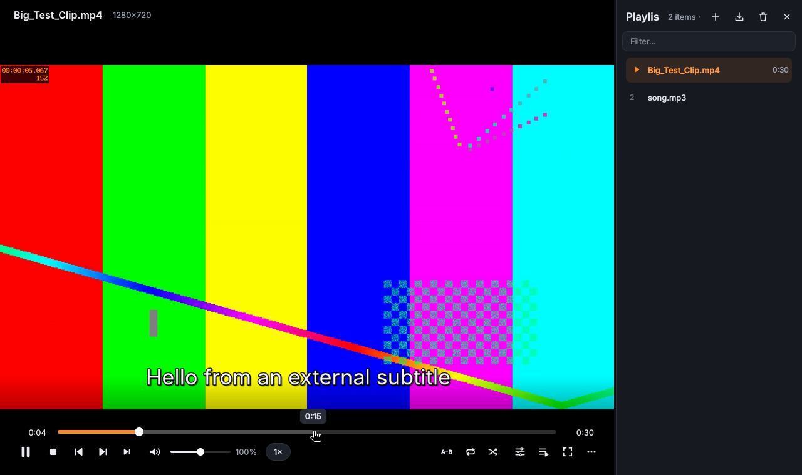

> VLClone is an independent frontend. It does not fork, modify or reverse
> engineer VLC; it uses the public libVLC API of an installed VLC.

## Windows download (no Python needed)

Releases are on the repository's **Releases** page: `VLClone-<version>-Setup.exe`
and `VLClone-<version>-win64-portable.zip`.

* **Installer**: Start menu entry, optional desktop icon, uninstaller, and
  opt-in tasks for **file types** (video / audio / playlists, unticked by
  default) and the Explorer entries **Play with VLClone** / **Add to VLClone
  playlist** (on Windows 11 under *Show more options*). Windows asks you to
  confirm the default player in *Settings → Default apps* (the installer can
  open it); VLClone only becomes the default by itself for types that had none.
  Uninstalling removes every entry it made and leaves other players' alone.
* **Portable zip**: unzip anywhere and run `VLClone.exe`; Settings → System →
  *File types* registers the same entries for your user only.

Both **bundle libVLC** (from the official VLC 3.0.21 win64 build, verified by
SHA-256), so VLC does not need to be installed. The exe is unsigned, so Windows
SmartScreen may ask you to confirm the first launch (*More info → Run anyway*).

**Making a release**: bump `__version__` in `vlclone/__init__.py` (the one place
the version lives: About, the update check, the exe's version resource and the
installer all read it), commit, then push a matching tag:

```bash
git tag v1.0.0 && git push origin v1.0.0
```

The *Windows build* workflow checks that the tag matches `__version__`, builds,
self-tests, and publishes a GitHub Release with both files and release notes
generated from the commits since the previous `v*` tag
(`packaging/release_notes.py`). Builds of ordinary pushes keep their files as
workflow artifacts for 3 days only (Actions → *Windows build* → run →
*Artifacts*); tag builds upload no artifact at all. If artifact storage is full,
*Run workflow* → tick *pre-release* publishes a `build-N` pre-release instead
(never offered by the update check).

To build locally on Windows:

```powershell
pip install -r requirements.txt pyinstaller pillow
python packaging\fetch_vlc.py
build\vlc\vlc-cache-gen.exe build\vlc\plugins
python packaging\make_icon.py
python packaging\make_version_info.py
python packaging\make_associations.py            # file types for the installer
pyinstaller packaging\vlclone.spec --noconfirm     # -> dist\VLClone\VLClone.exe
iscc /DAppVersion=1.0.0 packaging\installer.iss     # optional installer (Inno Setup 6)
```

Licensing note: the packages redistribute libVLC and VLC plugins, which are
licensed under the LGPL/GPL by VideoLAN; VLC's license is included as
`VLC-LICENSE.txt` and VLC's source is available from <https://www.videolan.org/>.

## Install from source on Windows

1. **Install VLC (64-bit)** from <https://www.videolan.org/vlc/>.
   On the download page pick *Windows 64-bit* (the default "Download VLC"
   button may give you the 32-bit build — use the small arrow next to it).
   VLClone needs a VLC whose bitness matches Python's; 64-bit Python +
   64-bit VLC is the normal setup. Installing to the default
   `C:\Program Files\VideoLAN\VLC` lets VLClone find `libvlc.dll`
   automatically (it also checks the registry).
2. **Install Python 3.10+ (64-bit)** from <https://www.python.org/downloads/windows/>
   and tick *Add python.exe to PATH*.
3. **Get the code and install the dependencies** (PowerShell):

   ```powershell
   git clone <this repo> VLClone
   cd VLClone
   py -m venv .venv
   .venv\Scripts\Activate.ps1
   pip install -r requirements.txt
   ```

4. **Run it**:

   ```powershell
   python run.py                 # or: python -m vlclone
   python run.py "D:\Movies\film.mkv" "D:\Music"   # open files/folders directly
   ```

If VLClone says *libVLC could not be loaded*, VLC is missing or has the wrong
bitness. You can also point it at a specific install with
`set PYTHON_VLC_LIB_PATH=C:\path\to\VLC\libvlc.dll`.

### macOS / Linux

Install VLC from your package manager (Linux: `vlc` or `libvlc5` plus
`vlc-plugin-base`/`vlc-plugin-video-output`), then `pip install -r requirements.txt`
and `python run.py`. On Linux VLClone forces the XCB (X11/XWayland) Qt
platform because libVLC embeds video into X11 windows; a compositing window
manager is needed for the translucent controls (every modern desktop has one).

## Using it

* **Open**: drop files, folders, playlists or links anywhere on the window, or
  use the buttons on the start screen, `Ctrl+O` (file), `Ctrl+F` (folder),
  `Ctrl+N` (network stream). Folders are scanned recursively and sorted
  naturally (`ep2` before `ep10`).
* **Open Media** (`⋯` → *Media*, or `Ctrl+Shift+O`) is VLC's Media menu in one
  dialog with four tabs, each with *Play* and *Enqueue*:
  * *File*: several files/folders at once, optionally with a subtitle file.
  * *Disc* (`Ctrl+D`): DVD, Blu-ray (unencrypted) or audio CD from a drive,
    a disc folder (`VIDEO_TS` / `BDMV`) or an ISO image. Optical drives are
    detected (Windows: every CD/DVD/BD drive with its volume label; the drive
    with a disc in it is preselected), and picking a folder or ISO detects
    the disc type. *Disc menus* on/off, starting title and chapter, or the CD
    track.
  * *Network* (`Ctrl+N`): URL with completion from your recent URLs (right-click
    to remove one, *Clear history*), a live hint of what VLC will do
    (*HLS stream*, *RTSP*, *YouTube (via VLC's Lua script)*…) or why the URL
    is wrong, and the network caching in ms. `www.…`, `youtu.be/…` and
    `@:1234` (UDP) are completed for you.
  * *Capture device* (`Ctrl+C`): webcam and microphone (DirectShow on
    Windows, V4L2/ALSA on Linux) with resolution, frame rate and caching.
  * Under every tab: *Start at* and *Extra options* (`:option=value`, as in
    VLC's "Show more options").
* **Streams that fail say why** instead of hanging: a toast names the host and
  the likely cause with a *Retry* button (YouTube failures point at VLC's
  `youtube.lua`, disc failures at encryption). Streams that never start give
  up after 20 s (Settings → Playback). YouTube pages and remote `.m3u` lists
  expand into their real entries in the playlist, as in VLC.
* **Chapters and titles**: files with chapters (MKV, MP4, DVD, Blu-ray) show
  them as gaps in the timeline; hovering shows the chapter name, and a
  `Ch 2/12` chip opens Quick settings → *Chapters* (chapter list, titles,
  disc-menu pad). `Shift+N` / `Shift+P` = next / previous chapter (previous
  restarts the current chapter after 3 s), `Shift+B` / `Shift+O` = next /
  previous title, `Shift+M` = disc menu. While a DVD menu is shown, the arrow
  keys and `Enter` navigate it.
* **Media library** (`Ctrl+Shift+L`, or *Library* on the start screen) takes the
  video's place; the playlist stays beside it. Add *Video* and *Music*
  folders (*Folders…*); they are scanned in the background, rescanned when
  their contents change and at every launch (only new or changed files are
  read again). Sections:
  * *Videos*: thumbnail grid with duration and resolution; sort by title,
    recently added, last played, duration, size or folder.
  * *Music*: artist → album → tracks from the files' tags.
  * *Recently played*: everything you played, including streams and discs.
  * *Continue watching*: files with a saved resume position, with progress.

  Search filters every section. Double-click plays (videos switch back to the
  player, music keeps playing while you browse); right-click → *Add to
  playlist* or *Show in folder*.
* **Controls** appear when you move the mouse and fade out after ~2 s of
  playback. Hover the timeline to see the time under the cursor; drag to scrub.
  Scroll anywhere over the video to change volume (up to 200 %, the boost zone
  is orange). Double-click toggles fullscreen.
* **Speed, A-B loop, repeat and shuffle** live in the quick-settings popover
  (the sliders button or `Ctrl+E`); click the `1×` chip to jump straight to it.
* **Playlist** is a sidebar (`Ctrl+L`): drag rows to reorder, drop files onto it
  to insert at a position, `Delete` removes, `Enter`/double-click plays,
  type in *Filter…* to search.

* **Tracks, subtitles and video**: the quick-settings popover also has
  *Audio* (track, delay), *Subtitles* (track, load `.srt`/`.ass`/…, delay) and
  *Video* (aspect ratio, crop, zoom, rotate, deinterlace, snapshot) pages. The
  same options are in the `⋯` menu / right-click menu. Dropping a subtitle file
  on a playing video loads it.
* **Effects & filters** (`Ctrl+Shift+E`, or *Effects…* in Quick settings →
  Audio/Video): a floating panel with
  * *Equalizer*: 10 bands (31 Hz–16 kHz) plus preamp, on/off, all 18 VLC
    presets (Flat, Classical, Club, Dance, Full bass, …, Rock, Pop, Techno),
    and your own presets (*Save…*, *Delete*). Double-click a slider to zero it.
  * *Audio*: volume normalization with its maximum level, stereo mode
    (stereo, mono, left, right, reverse) and the same audio delay control as
    Quick settings. Gain above 100 % stays on the main volume slider.
  * *Image*: brightness, contrast, hue, saturation, gamma, each with its own
    reset.
  * *Reset all* puts every effect back to neutral.

  Everything in the panel is **live**. Flip and sharpen sit next to rotate,
  crop, zoom and deinterlace in Quick settings → Video and are marked
  **↻ reloads**: libVLC applies them when media loads, so VLClone reloads the
  file at the same position (keeping pause state, tracks, subtitles, delays,
  A-B points). Several changes in a row are batched into one reload about
  0.6 s after the last one.
* **Convert / save** (`Ctrl+R`, *Media* menu, or right-click in the playlist or
  library → *Convert / save…*; drop files on the dialog to add them): pick a
  format, where to save (a folder, remembered, or next to each source) and
  optionally the resolution, video quality, audio bitrate, a trim range and
  subtitles to burn in. Several files make a batch. Formats this VLC cannot
  write are greyed out with the reason (see the table below).
  Conversions run in a separate libVLC instance, so playback carries on. The
  *Conversions* panel shows each job's progress and time left, with *Cancel*,
  *Show* (opens the folder), *Retry* and *Clear finished*; a toast says when a
  file is saved or why it failed. A job writes `name.ext.part` and only a
  verified result gets the real name; cancelling, a failure or quitting deletes
  the partial file, and an existing file is never overwritten (`film (1).mp4`).
* **Record** (`Shift+R`, or the ● button): records what is playing until you
  press it again; a red **● REC 0:12** stays on screen meanwhile. Files and other
  seekable media are saved as the stretch you watched, copied without
  re-encoding; live streams (IPTV, RTSP, radio) are copied to disk by a second
  connection while you watch. Recordings go to the folder in Settings → Interface →
  *Recordings* (default: Videos) as MKV.
* **Screen and camera recording**: Open Media → *Capture device* → *Screen*
  (frame rate, optional region, follow the mouse) or *Camera & microphone*, then
  **● Record to file**; stop it from the Conversions panel. Saved as MKV
  (H.264 + AAC).
* **Stream** (`Ctrl+S`): serves the current media to your network over HTTP as
  MPEG-TS, either the original streams or re-encoded to H.264 + AAC. Choose the
  port, copy the address shown (`http://192.168.x.y:8080/stream`) into VLC on
  another device, *Stop streaming* when done. The stream starts at the current
  position and then runs on its own.
* **Effect settings persist**, either one set for every file (default) or per
  file (Settings → Audio & video → *Effect settings apply to*). Per-file mode:
  each file remembers its own effects; new files start from the global set.
  Rotation, aspect ratio, crop, zoom and deinterlace follow the same setting.
* **Resume**: files continue where you stopped (with a *Start over* button).
* **Playlist restore**: the playlist comes back on the next launch with the
  last item selected (Settings → Playback; turn off to start empty).
* **Media information** (`Ctrl+I`) shows metadata, codecs, resolution, frame
  rate, audio format and live bitrate/frame statistics.
* **Settings** (`Ctrl+P`) has seven short sections: *Playback*, *Audio & video*,
  *Appearance*, *Library & files*, *System*, *Shortcuts*, *About*. The search
  box filters every section at once (setting names, descriptions and
  shortcuts); each section has *Reset … to defaults* (applied when you press
  *Save*, so *Cancel* undoes it).
* **Themes**: *Dark*, *Light* or *Follow system* (switches with Windows' app
  mode), plus an accent colour (eight presets or any colour). Every panel,
  dialog, menu and popover follows; the video area and its controls stay dark
  in every theme, like other players. Chosen in Settings → Appearance or on the
  welcome screen.
* **One window** (Settings → System): opening files from Explorer or starting
  VLClone again sends them to the running window instead of opening a second
  one: *Play now* (default) or *Add to the playlist*. Selecting many files in
  Explorer and pressing Enter adds them all and plays the first. `--new-instance`
  opens a separate window anyway; `--play` / `--enqueue` force the mode.
* **Mini player** (`Ctrl+Shift+M`, the button above the video, *View* menu): a
  small frameless always-on-top window with play/pause, previous/next, mute,
  the seek bar and the title. Drag it anywhere; it remembers its spot.
  Double-click, `Esc` or the ⤢ button bring the full window back.
* **Picture in picture** (`Ctrl+Shift+T`, the pin above the video): keeps the
  normal window above other windows.
* **Seek previews**: hovering the timeline of a local video shows a thumbnail of
  that moment. Frames are made in the background (a separate libVLC instance)
  and cached next to the library thumbnails, so a file is decoded once.
* **Windows integration**: the keyboard's media keys and the Windows media
  overlay (volume flyout / lock screen: title, play/pause, next/previous);
  previous / play-pause / next buttons under the taskbar thumbnail and playback
  progress on the taskbar icon; the screen does not sleep while a *video*
  plays (it may for music or when paused). Each can be turned off in
  Settings → System.
* **Window placement**: size, position, monitor, maximized and fullscreen are
  restored on the next launch. If that monitor is gone, its arrangement
  changed or its scaling changed, the window is moved onto a monitor that
  exists and shrunk to fit.
* **Welcome screen** on the first launch: theme and accent, file types (Windows)
  and library folders (`Videos` / `Music` are suggested). *Skip* changes nothing.
* **Updates**: once a day at most, on launch, VLClone asks GitHub Releases for a
  newer version and shows a toast with *Download*; it never installs anything.
  Off in Settings → System; *Check for updates* in About.
* **If VLClone crashes**, the next launch says so and offers *Open log folder*
  (crash report with the native fault trace and the end of the log). Logs
  rotate in `%LOCALAPPDATA%\VLClone\logs` (`~/.local/share/vlclone/logs`).

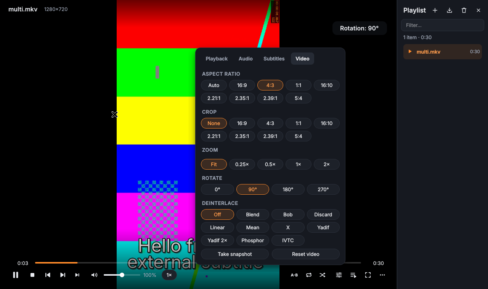

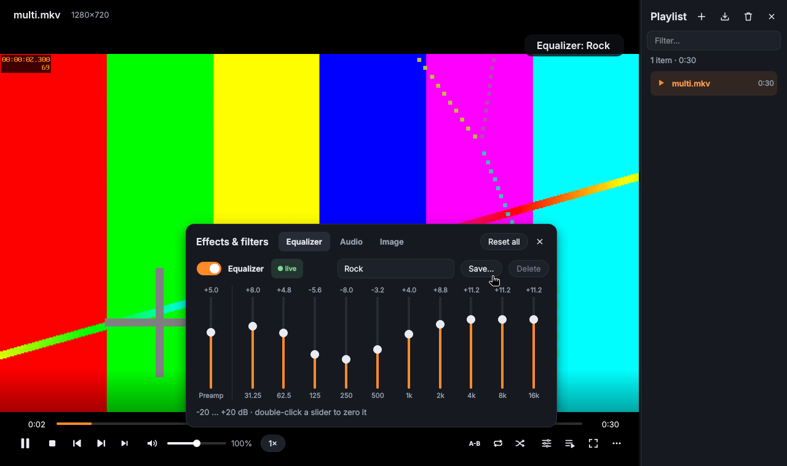

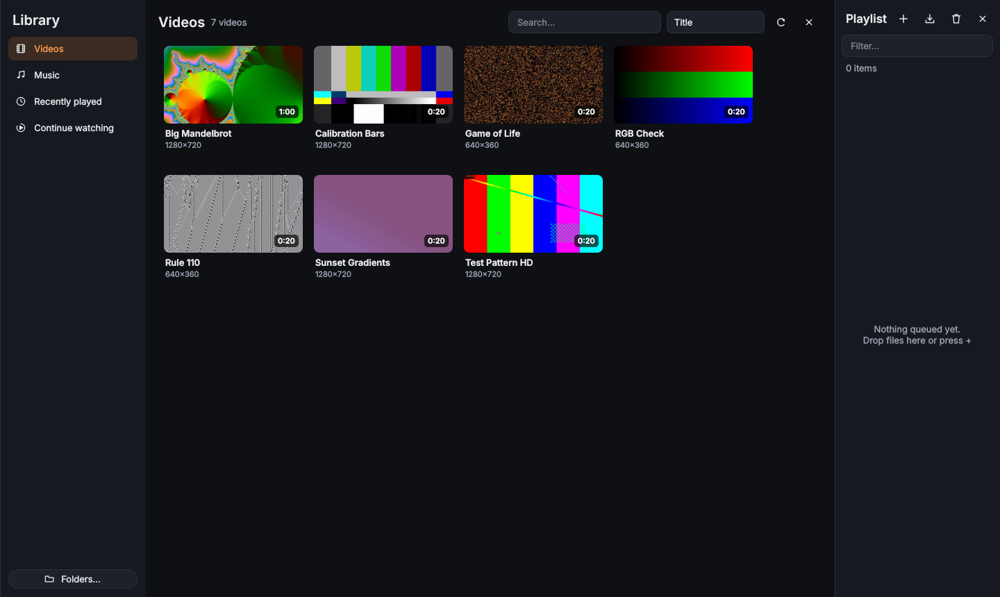

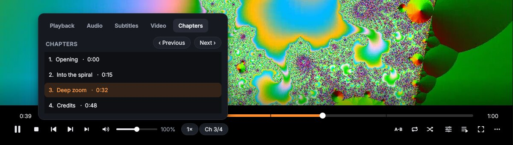

<p>
  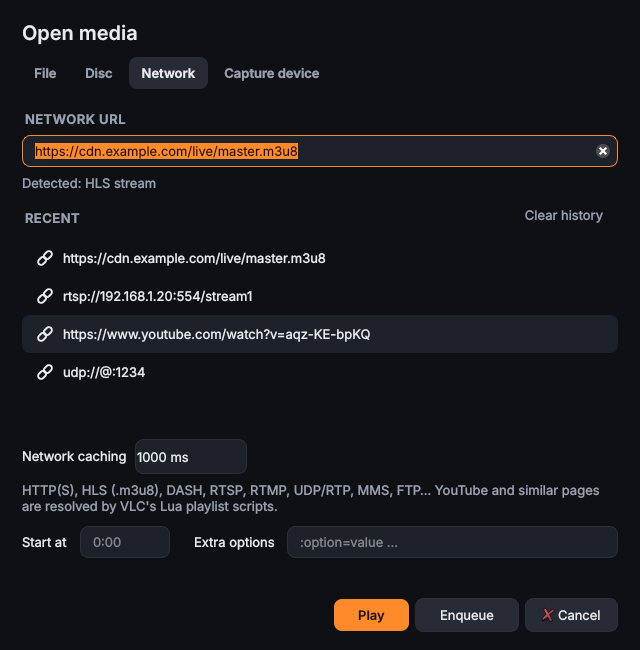
  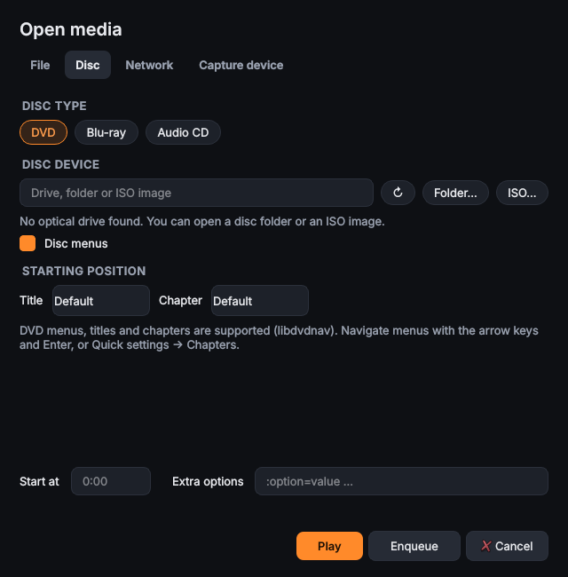
</p>

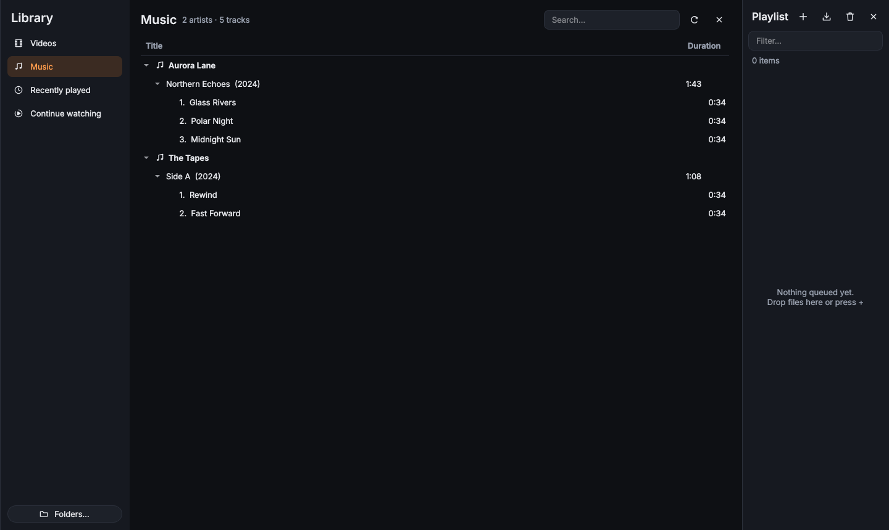

<p>
  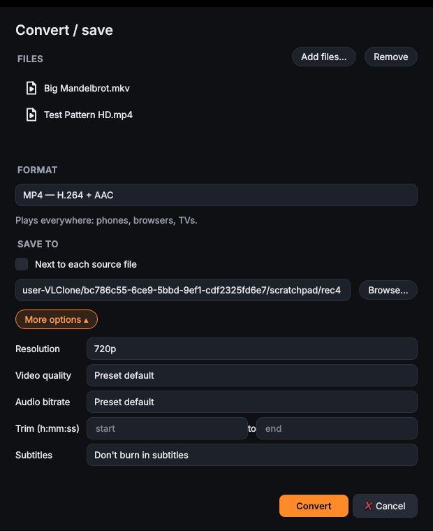
  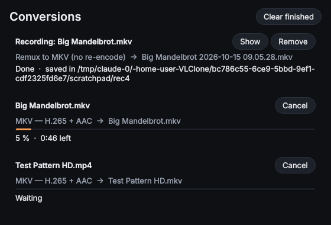
</p>

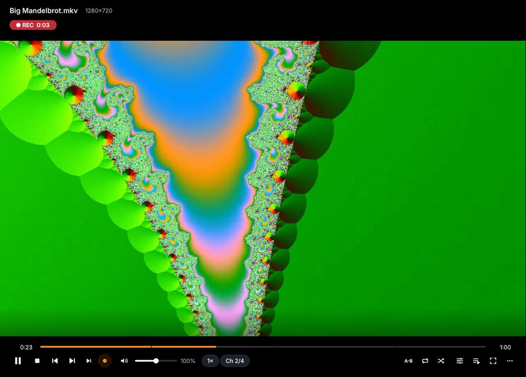

<p>
  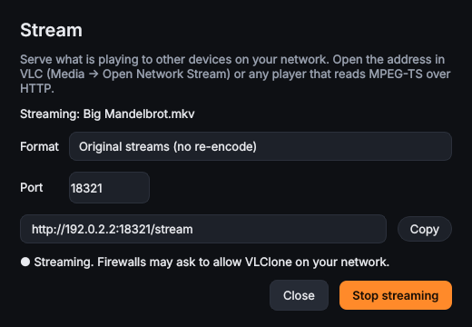
  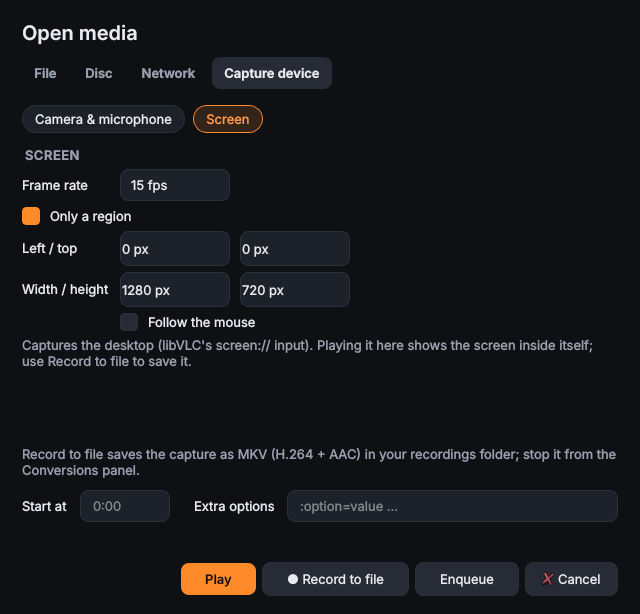
</p>

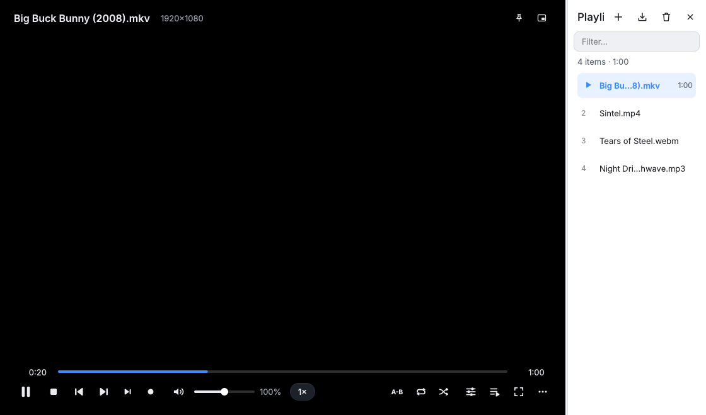

<p>
  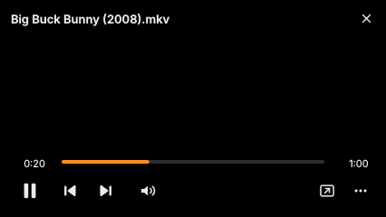
  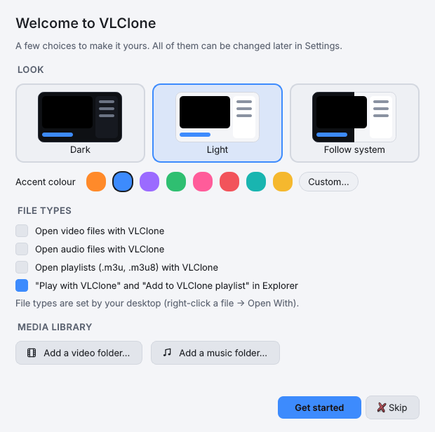
</p>

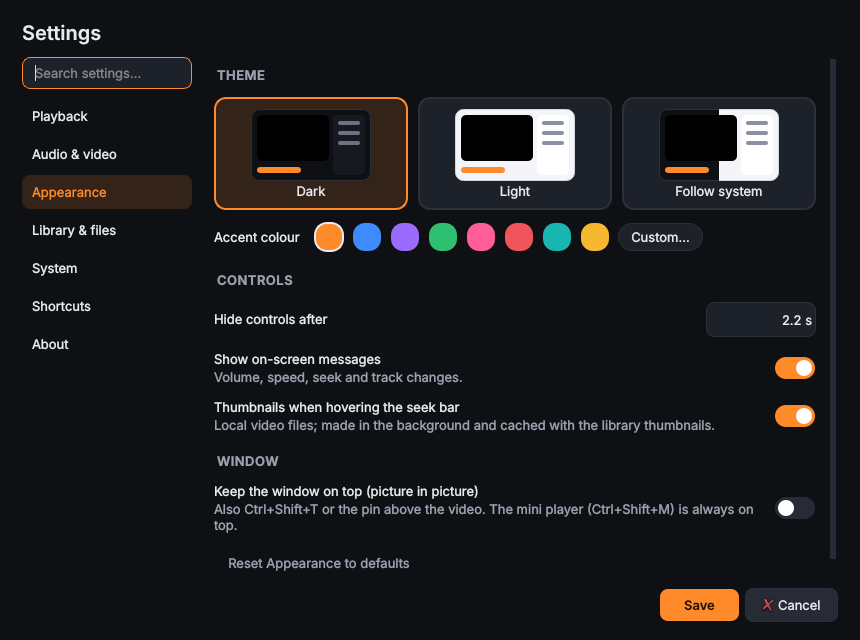

### Convert formats

VLClone converts a tiny generated clip with every preset the first time it
runs (about 3 s in the background, cached per libVLC version) and checks the
codecs actually written, so a preset that only *seems* to work is disabled.

| Preset | sout chain (simplified) | Bundled libVLC 3.0.21 (Windows) | libVLC 3.0.20 (Ubuntu 24.04) |
| --- | --- | --- | --- |
| MP4 — H.264 + AAC | `vcodec=h264,acodec=mp4a` → `mux=mp4` | ✅ | ✅ |
| MKV — H.264 + AAC | `vcodec=h264,acodec=mp4a` → `mux=mkv` | ✅ | ✅ |
| MKV — H.265 + AAC | `vcodec=hevc,acodec=mp4a` → `mux=mkv` | ✅ | ✅ |
| WebM — VP8 + Vorbis | `vcodec=VP80,acodec=vorb` → `mux=webm` | ✅ | ✅ |
| WebM — VP9 + Opus | `vcodec=VP90,acodec=opus` → `mux=webm` | ✅ | ✅ |
| MP3 | `acodec=mp3` → `mux=raw` | ✅ | ✅ |
| FLAC | `acodec=flac` → `mux=raw` | ✅ | ✅ |
| OGG — Vorbis / Opus | `acodec=vorb` / `opus` → `mux=ogg` | ✅ | ✅ |
| Audio only — AAC (M4A) | `acodec=mp4a` → `mux=mp4` | ✅ | ✅ |
| Remux to MKV / MP4 | no transcode, `:sout-all` | ✅ | ✅ |

No preset is disabled on either build (the Windows column comes from the
build's self-test). Things the probing turned up:

* `acodec=mpga` writes MPEG-1 **layer II** into a `.mp3`; the MP3 preset uses
  `acodec=mp3` and the check reads the frame header to make sure it is layer III.
* A remux (stream copy) can only start at a keyframe: a trim starting at 0:05
  begins at the keyframe before it. Re-encoding presets trim exactly.
* Remux to MP4 accepts H.264/H.265/MPEG-4 video and AAC/MP3/AC-3/ALAC audio;
  other codecs are refused before starting with a pointer to Remux to MKV.
* When a *live* input (screen, camera, live stream) is stopped, libVLC 3 drops
  the frames x264 holds in its look-ahead, and cannot finish an MP4 at all.
  Live recordings therefore use `venc=x264{tune=zerolatency}` and MKV (MPEG-TS
  if Matroska were unavailable).

### Keyboard shortcuts (VLC defaults)

| Action | Keys |
| --- | --- |
| Play / pause | `Space` |
| Stop | `S` |
| Previous / next | `P` / `N` |
| Next frame | `E` |
| Fullscreen / leave | `F` (or double-click) / `Esc` |
| Jump 3 s / 10 s / 1 min / 5 min | `Shift`/`Alt`/`Ctrl`/`Ctrl+Alt` + `←` `→` (plain `←` `→` = 10 s) |
| Jump to time | `Ctrl+T` |
| Faster / slower / normal | `]` or `+` / `[` or `-` / `=` |
| Volume up / down / mute | `Ctrl+↑` / `Ctrl+↓` / `M` |
| A-B loop | `Shift+L` |
| Repeat mode / shuffle | `L` / `R` |
| Cycle audio track | `B` |
| Cycle subtitle / toggle subtitles | `V` / `Shift+V` |
| Subtitle delay −/+ 50 ms | `G` / `H` |
| Audio delay −/+ 50 ms | `J` / `K` |
| Aspect ratio / crop / zoom | `A` / `C` / `Z` |
| Deinterlace mode | `D` |
| Snapshot | `Shift+S` |
| Show position | `T` |
| Playlist / quick settings | `Ctrl+L` / `Ctrl+E` |
| Effects & filters | `Ctrl+Shift+E` (not a VLC default; `Ctrl+E` is Quick settings) |
| Rotate / flip horizontally / flip vertically | `Ctrl+Alt+R` / unbound / unbound (assign in Settings → Shortcuts) |
| Next / previous chapter | `Shift+N` / `Shift+P` |
| Next / previous title, disc menu | `Shift+B` / `Shift+O`, `Shift+M` |
| Disc menu navigation | `↑` `↓` `←` `→` `Enter` (only while a menu is shown) |
| Media library | `Ctrl+Shift+L` |
| Mini player / always on top (picture in picture) | `Ctrl+Shift+M` / `Ctrl+Shift+T` |
| Media keys (play/pause, stop, next, previous) | the keyboard's media keys, also through the Windows media overlay |
| Convert / save, stream | `Ctrl+R`, `Ctrl+S` |
| Record / stop recording | `Shift+R` |
| Media information | `Ctrl+I` (or `Ctrl+J`) |
| Settings | `Ctrl+P` |
| Save playlist | `Ctrl+Y` |
| Open file / folder / stream | `Ctrl+O` / `Ctrl+F` / `Ctrl+N` |
| Open disc / capture device / Open Media | `Ctrl+D` / `Ctrl+C` / `Ctrl+Shift+O` |
| Quit | `Ctrl+Q` |

## Architecture

```
vlclone/
  core/            # no Qt imports — unit-tested
    backend.py       MediaBackend interface (the only contract with the engine)
    vlc_backend.py   libVLC implementation (the only module importing `vlc`)
    fake_backend.py  deterministic in-memory backend for tests / UI work
    controller.py    PlayerController: all player behaviour + observer signals
    effects.py       effects model, EQ presets, transform composition, Debouncer,
                     preset + per-file stores, persisted geometry
    network.py       URL checks, protocol detection, recent-URL history, error text
    discs.py         DVD / Blu-ray / CD MRLs, VIDEO_TS/BDMV/ISO detection, drives
    capture.py       dshow / v4l2 / alsa MRLs, Linux device discovery
    library.py       media library store (SQLite): folders, metadata, history
    library_scanner.py  background scan, folder watching, thumbnails (LibraryService)
    png.py           tiny PNG writer for thumbnails
    transcode.py     convert presets, sout chains, output naming and checks
    converter.py     TranscodeEngine contract, ConvertQueue, preset probe
    recorder.py      Record button (segment remux / live copy)
    streamer.py      HTTP streaming of the current media
    session.py       playlist persistence between sessions
    settings.py      settings, sections, versioned migration of older files
    instance.py      single-instance message format and Explorer batching
    windowstate.py   window restore plan (monitors, scaling), mini-player spot
    desktop.py       what the OS sees: keep-awake rule, taskbar state, media-key de-dup
    seek_preview.py  seek-bar thumbnails on a worker thread
    updates.py       version comparison, once-a-day GitHub Releases check
    diagnostics.py   rotating logs, crash markers and reports
    associations.py  file types + Explorer verbs as data (installer and app)
    playlist.py      ordering, current item, repeat, shuffle
    abloop.py, stepping.py, timefmt.py, media_sources.py
    m3u.py, resume.py, shortcuts.py, paths.py
  integration/     # OS calls only, each optional (no-op elsewhere)
    win_taskbar.py   ITaskbarList3 via ctypes COM: thumbnail buttons, progress
    win_media.py     media overlay (SMTC) + media keys via pywinrt
    win_assoc.py     per-user file types (portable zip)
    power.py         keep-awake (SetThreadExecutionState / freedesktop inhibit)
  ui/              # PySide6 widgets, talk only to PlayerController
    main_window.py   window, sidebar, menus, wiring
    overlay.py       translucent always-on-top controls window over the video
    quick_settings.py popover with pluggable pages (… Video, Chapters)
    effects_panel.py  Effects & filters panel (equalizer, audio, image)
    open_media.py    Open Media dialog (File, Disc, Network, Capture device + screen)
    convert_dialog.py Convert / save dialog and the Conversions panel
    stream_dialog.py Stream dialog
    library_view.py  media library view, folder manager
    theme.py         palettes, accent maths, style sheets, live switching
    instance.py      QLockFile + QLocalServer transport for single instance
    desktop.py       feeds the integrations from the window timer
    welcome.py       welcome screen, crash notice, theme picker, file types box
    playlist_panel.py, widgets.py, icons.py (vector, high-DPI) …
```

* **libVLC renders into a native child window**, which Qt can't paint over, so
  the controls live in a frameless translucent tool window that tracks the
  video rectangle. Its background is 1/255 opaque, which makes it invisible but
  still able to receive clicks, wheel, drag-and-drop and cursor motion.
* **No libVLC callbacks reach the UI.** The window calls
  `PlayerController.tick()` every 100 ms on the Qt thread; the controller polls
  the backend and emits plain-Python signals. This sidesteps libVLC's event
  threads entirely.
* Per-media state (volume, speed, video adjustments, pending resume seek) is
  re-applied when playback actually starts, because libVLC drops some of it
  while a media is still opening.
* **Live vs. reload effects.** Equalizer, stereo mode, normalization and image
  adjust use libVLC calls that act on the playing media. Video filters
  (rotate/flip via `transform`, `sharpen`) are only honoured by libVLC per
  *instance*, so `VlcBackend` keeps a small LRU of libVLC instances keyed by
  `EngineFilters` and swaps the player when the media is reloaded. The
  controller batches requests with a `Debouncer` polled from `tick()` and
  reuses the reload-with-position path (`_start_current(reload=True)`).
  Rotation and flips are combined into one of the eight `transform` types.
* **Volume normalization** has no public libVLC switch (libVLC routes the
  audio filter chain through its equalizer call). `VlcBackend` sets the
  chain (`equalizer:normvol`) on the player's audio output through
  libvlccore's exported variable API, as VLC's own UI does. That relies on the
  3.0.x plugin ABI, so it only enables itself on libVLC 3.0 and the toggle is
  disabled (with a tooltip) if the hook isn't available.
* **Media sources are MRLs plus media options.** Every source ends up in
  `PlayerController.open(inputs, options=…, title=…)`: discs are
  `dvd:///D:/#title:chapter`, `dvdsimple://`, `bluray://` (+ `:no-bluray-menu`),
  `cdda://` (+ `:cdda-track=N`); capture is `dshow://` + `:dshow-vdev=…`;
  caching is `:network-caching=…`. Options live on the playlist item, so they
  survive reloads, the session file and `.m3u` (`#EXTVLCOPT`, like VLC).
* **Chapters/titles** are polled from the backend (once a second while
  playing, and after title changes) and arrive as `chapters_changed`.
  YouTube pages and remote playlists "end" in libVLC with sub-items; the
  controller replaces the playlist entry with them (reusing the sub-item media,
  so options set by VLC's Lua scripts are kept).
* **DirectShow devices** are listed the way VLC's preferences do it: libvlccore's
  `config_GetPszChoices("dshow-vdev")` runs the dshow module's own enumerator.
* **Media library**: `LibraryService` runs one worker thread at a time (scan,
  folder check, thumbnails) with its own libVLC instance (`VlcMediaProbe`).
  Like the player, nothing calls back into Qt: the view polls `status` and a
  `generation` counter twice a second. SQLite (WAL, one connection per thread)
  lives in the data folder (`%LOCALAPPDATA%\VLClone\library.db` on Windows,
  `~/.local/share/vlclone` on Linux) with thumbnails next to it. Metadata comes
  from libVLC's local preparser; thumbnails decode one frame a third of the
  way in through libVLC's `vmem` callbacks (no window needed) and are written
  with a small PNG encoder. Folder changes are noticed by comparing directory
  modification times every 30 s.
* **Convert, record and stream share a second libVLC instance**
  (`VlcTranscoder`, behind the `TranscodeEngine` contract; `FakeTranscoder` in
  tests). A job is a media player whose media carries `:sout=#transcode{…}:
  std{access=file,mux=…,dst='…'}` (or `access=http` for streaming), so nothing is
  shown or heard and the main player is untouched. `ConvertQueue` runs one file
  conversion at a time with live jobs alongside and is polled from the UI timer;
  progress is the job's time over the (trimmed) length. Finishing means
  stopping the player (muxers write their index then), checking the result's
  codecs and renaming the `.part` file.
* **Recording** has no public libVLC 3 call (VLC uses an internal input
  variable), so it reuses the convert pipeline: segment remux for seekable
  media, a parallel copy for live streams.
* **Single instance**: the first process takes `instance.lock` (`QLockFile`) in
  the config folder and listens on a per-user local socket (a named pipe on
  Windows); later processes send their command line as one JSON line and exit.
  A lock left by a crash is stale once its process is gone and is taken over
  (with the leftover socket file); if the owner is alive but hung, the new
  process opens the files itself after a few seconds instead of exiting. The
  window batches messages that arrive within 0.5 s (Explorer starts one
  process per selected file).
* **Mini player and picture in picture** are the main window with other window
  flags (frameless + always on top) and a compact overlay, so libVLC keeps
  drawing into the same native window. Should a platform recreate that window
  on a flag change, the new handle is given to libVLC and the media reloads at
  the same position.
* **Themes** rewrite the tokens in `ui/theme.py` and re-apply one style sheet;
  painted widgets read the tokens at paint time and icons can name a token
  (`"@ACCENT"`), so nothing has to be rebuilt. The overlay has its own
  always-dark style sheet.
* **Taskbar and media overlay**: Qt 6 has no taskbar API any more, so
  `integration/win_taskbar.py` calls `ITaskbarList3` through ctypes (buttons are
  added when Explorer sends *TaskbarButtonCreated*; clicks arrive as
  `WM_COMMAND` in `MainWindow.nativeEvent`). The media overlay borrows the
  SMTC of a `Windows.Media.Playback.MediaPlayer` (via pywinrt) whose own
  command handling is off. Both only translate `core/desktop.py`'s decisions.
* **Settings files are versioned** (`settings_version`). `migrate()` upgrades
  files from older versions step by step: a phase 1-4 file is version 1, skips
  the welcome screen, and keeps a user's custom shortcut when a new default
  (Ctrl+Shift+M, Ctrl+Shift+T…) would collide with it.

### Adding the later VLC features

The structure is meant to absorb VLC's bigger features without rewrites:

1. Extend `MediaBackend` with the engine calls (e.g. `set_equalizer(bands)`,
   `set_video_filter(...)`, `stream_out(sout_chain)`) and implement them in
   `VlcBackend` and `FakeBackend`.
2. Add behaviour + state to `PlayerController` (or a sibling controller in
   `core/`, e.g. `core/equalizer.py`, `core/library.py`), with tests.
3. Expose it in the UI: register actions in `MainWindow.register_feature_actions`,
   add a page with `QuickSettings.add_page(...)`, add menu entries in
   `MainWindow.extend_menu`, and settings fields in `core/settings.py`.

| Future feature | Where it plugs in |
| --- | --- |
| Equalizer / audio effects | ✅ phase 2 (`effects.py`, `effects_panel.py`) |
| Video effects & filters | ✅ phase 2 (adjust live; transform/sharpen via `EngineFilters`) |
| More VLC video filters (e.g. gradfun, posterize) | add a field to `VideoEffects` + `EngineFilters.vlc_args()`; they reuse the batched reload |
| Convert / stream out | a `core/transcode.py` driving a second libVLC instance with `:sout=` options, a dialog |
| DVD / Blu-ray / discs, chapters | ✅ phase 3 (`discs.py`, chapter/title/navigate in the backend) |
| Network streams, capture devices | ✅ phase 3 (`network.py`, `capture.py`, Open Media dialog) |
| Media library | ✅ phase 3 (`library.py`, `library_scanner.py`, `library_view.py`) |
| Convert / stream out / record | ✅ phase 4 (`transcode.py`, `converter.py`, `recorder.py`, `streamer.py`) |
| Playlists/podcasts/UPnP discovery | a backend `media_discoverer` wrapper + a library section |
| Daily-driver polish, Windows integration | ✅ phase 5 (see the table below) |

## Status

All eight core-player priorities (phase 1), the effects work (phase 2), media
sources + library (phase 3), convert/record/stream (phase 4) and the
daily-driver polish (phase 5) are implemented:

| # | Feature | State |
| --- | --- | --- |
| 1 | Open files, folders (recursive), URLs/network streams, `.m3u`, drag-and-drop | ✅ |
| 2 | Play/pause, stop, seek bar with hover time, frame step, volume to 200 %, mute, fullscreen | ✅ |
| 3 | Speed (presets + fine slider), A-B loop, repeat off/all/one, shuffle | ✅ |
| 4 | Embedded + external subtitles, subtitle delay, audio track, audio delay | ✅ |
| 5 | Aspect ratio, crop, zoom, rotate, deinterlace, snapshot | ✅ |
| 6 | Playlist reorder, save/load `.m3u`, per-file resume | ✅ |
| 7 | Media info (codec, resolution, bitrate, statistics) | ✅ |
| 8 | VLC default shortcuts, editable | ✅ |
| P2 | 10-band equalizer, 18 VLC presets, preamp, on/off, custom presets | ✅ live |
| P2 | Volume normalization (max level), stereo modes | ✅ live (normalization: libVLC 3.0 only) |
| P2 | Image adjust: brightness, contrast, hue, saturation, gamma | ✅ live |
| P2 | Flip horizontal/vertical, sharpen with strength | ✅ batched reload |
| P2 | Effects persisted globally or per file; playlist restored on launch | ✅ |
| P3 | Open Media dialog: File, Disc, Network, Capture device | ✅ |
| P3 | Network: HTTP(S), HLS, RTSP, RTMP, UDP/RTP, YouTube (Lua), history, caching, clear errors + timeout | ✅ (HTTP/HLS/errors tested with real libVLC) |
| P3 | DVD (menus, titles, chapters), Blu-ray (unencrypted), audio CD; drive detection; folder/ISO | ✅ (needs a Windows test with real discs) |
| P3 | Chapter list, next/previous chapter, chapter marks on the seek bar | ✅ (MKV/MP4 tested with real libVLC) |
| P3 | Webcam / microphone via DirectShow, resolution and frame rate | ✅ (needs a Windows test with a camera) |
| P3 | Media library: watched folders, background scan, SQLite, metadata, thumbnails, four views, search/sort | ✅ |
| P3 | Rotation, aspect, crop, zoom, deinterlace persisted with the effects scope | ✅ |
| P4 | Convert / save: 12 presets, batch queue, scale, bitrates, trim, subtitle burn-in, separate engine | ✅ (every preset converted and checked with real libVLC; MP4 + MP3 on Windows in CI) |
| P4 | Presets probed at runtime and disabled with a reason when unsupported | ✅ |
| P4 | Queue: progress, ETA, cancel, show in folder, retry; no partial files left | ✅ |
| P4 | Record (Shift+R) with REC indicator; screen and camera recording | ✅ (screen recording tested on X11; needs a Windows check) |
| P4 | HTTP streaming (copy or H.264 + AAC, port, URL) | ✅ (fetched locally in tests and in the Windows self-test) |
| P5 | Single instance: Explorer / second launch hand files to the running window, play now or enqueue, stale lock after a crash | ✅ (tested across real processes; Windows self-test hands off to a second exe) |
| P5 | Installer: opt-in file types, Play with / Add to playlist in Explorer, clean uninstall; per-user registration for the zip | ✅ (needs a manual check on Windows) |
| P5 | Media keys, Windows media overlay (SMTC), taskbar buttons + progress | ✅ (needs a manual check on Windows; the self-test creates both) |
| P5 | Keep the screen on while a video plays (not audio, not paused) | ✅ |
| P5 | Dark / light / follow-system themes, accent colour | ✅ (screenshot check of every theme on a virtual display) |
| P5 | Mini player, picture in picture | ✅ |
| P5 | Seek-bar thumbnails (background, cached with the library's) | ✅ |
| P5 | Window size/position/monitor/fullscreen restored (multi-monitor, scaling) | ✅ (restore plan unit-tested; needs a real multi-monitor check) |
| P5 | Settings in sections with search and per-section reset; versioned settings with migration | ✅ |
| P5 | Welcome screen, crash report + Open log folder, rotating logs | ✅ |
| P5 | Update check (GitHub Releases, once a day, notify only); version from one place; tag → release with notes | ✅ |

Known limitations / not yet done:

* Rotate, flip and sharpen reload the media (libVLC only applies video
  filters per instance); position, pause state, tracks, external subtitles,
  delays and live effects are restored, but there is a brief flash. Live
  streams restart from the live edge.
* Turning image adjust on or off (moving away from / back to all-neutral
  values) rebuilds libVLC's video filter chain once, which can show a single
  dropped frame; moving sliders after that is smooth.
* Seek thumbnails are for local files only (not streams or discs); the first
  hover over a not-yet-made spot shows the nearest ready frame or just the
  time, the exact frame appears a moment later. Making them decodes the file a
  second time in the background (about 0.1-0.5 s per frame).
* Windows decides the default player: the installer and Settings register
  VLClone properly, but for types another program already owns you confirm the
  switch in Settings → Default apps. Registering file types from Settings only
  works in the packaged `VLClone.exe` (from source there is no exe to point at).
* The media overlay needs the `winrt-*` packages (bundled in the Windows build);
  without them media keys still work while VLClone has focus. Cover art is not
  sent to the overlay.
* The taskbar flyout's icons follow Windows' *system* theme at launch; switching
  the taskbar between light and dark while VLClone runs keeps the old icon
  colour until the next start.
* Keep-awake on Linux uses the freedesktop ScreenSaver D-Bus interface (GNOME,
  KDE, Xfce…); other desktops are not covered. Taskbar and media overlay are
  Windows-only.
* The update check only notifies; it reads `api.github.com` (unauthenticated,
  60 requests/hour per IP, far above once a day).
* Development and screenshots were done on Linux (X11 + compositor, real
  libVLC 3.0.20). The Windows path (HWND embedding, `libvlc.dll` discovery)
  follows libVLC's documented API but should be smoke-tested on a Windows box.
* DVD menus are driven with the keyboard (arrows, `Enter`) or the pad in
  Quick settings → Chapters; clicking menu buttons with the mouse is not
  supported, because the controls overlay sits above libVLC's video window.
* Blu-ray: only unencrypted discs (VLC ships no AACS/BD+ keys); interactive
  BD-J menus need Java, which the bundled VLC lacks, so turn *Disc menus*
  off if a disc shows nothing.
* YouTube relies on the `youtube.lua` that ships with VLC 3.0.21. YouTube
  changes often and that script is frequently out of date; when a link fails
  the error says so. Replacing `vlc\lua\playlist\youtube.luac` with a newer
  `youtube.lua` from VideoLAN fixes it without rebuilding.
* Capture resolutions are requested, not negotiated: DirectShow does not
  report the list of formats through libVLC, so the dialog offers common
  sizes and the camera falls back to its default if one is unsupported.
* The library only reads local metadata (tags, stream info); it does not
  download cover art or look things up online. Music without tags is grouped
  under "Unknown artist", with the folder as album only when libVLC is not
  available.
* Folder watching compares directory times every 30 s rather than using OS
  change notifications; renaming a file inside an existing folder is picked
  up on that check, edits to a file's tags on the next launch or *Rescan*.
* Recording a file saves the stretch between pressing Record and stopping,
  measured on the media's timeline; seeking while recording changes what that
  stretch is. It starts at the keyframe before the start (stream copy).
* The Record button does not record cameras or the screen (a capture device
  cannot be opened twice); use Capture → *Record to file* for those. Live MP4
  is not possible with libVLC 3, so all live recordings are MKV.
* Streaming re-opens the media in the second engine from the current position;
  pausing or seeking the player afterwards does not affect the stream. Only
  MPEG-TS over HTTP is offered (players like VLC, mpv, Kodi read it; browsers do
  not). Windows Firewall asks the first time.
* Conversions are not resumable: quitting with conversions running asks first
  and then cancels them (a running recording is saved).
* Later phases from the roadmap: network discovery (UPnP/SMB), more of VLC's
  effect filters.

## Development

```bash
pip install -r requirements-dev.txt
python -m pytest            # core + offscreen UI tests
python run.py --fake-backend   # UI without libVLC
```

`tests/test_vlc_backend.py` and `tests/test_vlc_phase3.py` run against a real
libVLC when one is installed and are skipped otherwise. They serve files and an
HLS stream from a local HTTP server, check 404 and refused connections, read
chapters, tags and sizes, make thumbnails and scan a library with the real
probe; clips come from `ffmpeg` when present, and `vlclone/selftest_media.py`
writes a chaptered Matroska file and a Y4M video in pure Python otherwise.

`VLClone.exe --self-test report.txt` (run by the Windows build) plays a tone
through a filtered instance, applies the effects, reads chapters from a
generated MKV and jumps between them, plays a local HTTP stream, checks that a
404 fails, makes a library thumbnail and lists capture devices and optical
drives, runs an MP4 and an MP3 conversion through the queue, probes every
convert preset (the build shows the working/disabled lists as notices) and
fetches an HTTP stream.

Phase 5 adds: `tests/test_phase5_core.py` (settings migration, update-version
comparison and the once-a-day rule, handoff protocol and batching, the window
restore plan for unplugged / rearranged / rescaled monitors, keep-awake and
taskbar rules, crash reports, log rotation, file-type entries, release notes),
`tests/test_instance.py` (handoff between real processes, a crashed owner's
stale lock, a hung owner), `tests/test_ui_theme.py` (switching dark / light /
system and accent with windows open), `tests/test_ui_phase5.py` (mini player,
picture in picture, handoff into the playlist, window state, seek previews,
settings search and reset, welcome screen, update toast) and
`tests/test_vlc_phase5.py` (real-libVLC thumbnails are RGB frames at the
requested time; this caught library thumbnails being grey luma since phase 3).

`tests/test_screenshots.py` renders every theme (dark, light, follow-system,
custom accents) and the mini player, composites the overlay over the video and
checks backgrounds, popovers, the accent and the dark video stage pixel by
pixel. The workflow's *ui-screenshots* job runs it on a virtual X display and
keeps the PNGs for 3 days:

```bash
xvfb-run -a env QT_QPA_PLATFORM=xcb VLCLONE_SCREENSHOT_DIR=shots python -m pytest tests/test_screenshots.py
```

The Windows self-test also starts the packaged exe a second time with
`--enqueue` and checks that the first instance received the file, checks the
update logic against a local mock of the GitHub API, and creates the media
overlay, the taskbar COM object and a keep-awake request.

`tests/test_vlc_phase4.py` converts a clip with every preset the local libVLC
supports and checks the codecs with VLC and `ffprobe`, checks exact trims and
scaling, remuxes both ways, cancels mid-way, records a file segment and a live
HTTP stream, fetches the HTTP stream output and, when a display is available,
records the screen.
